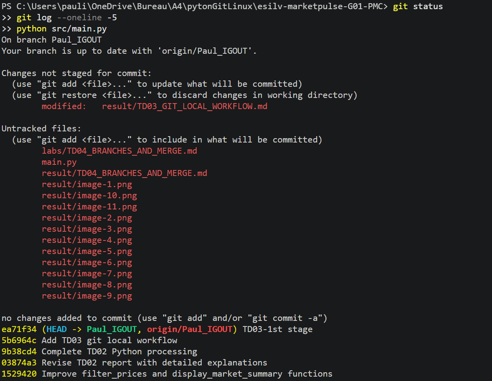
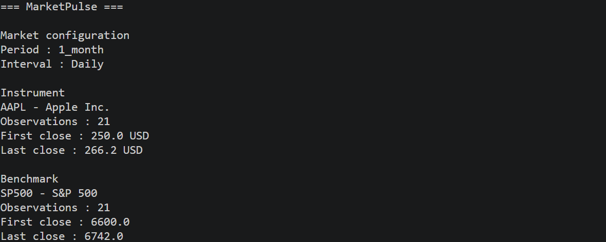
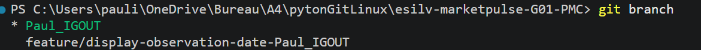
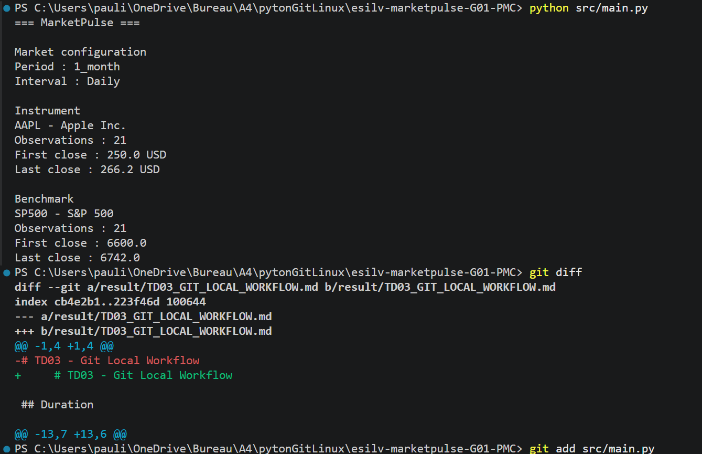
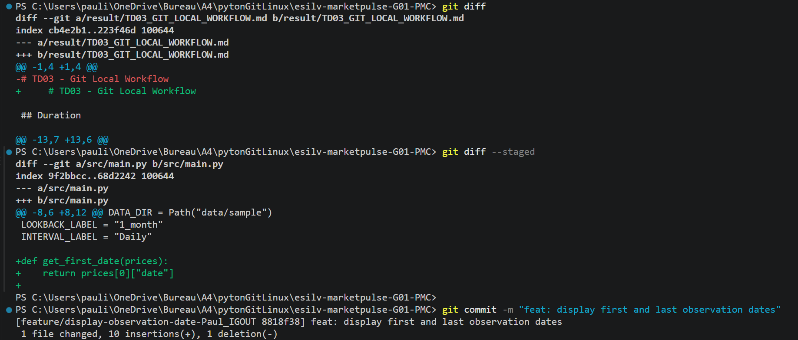
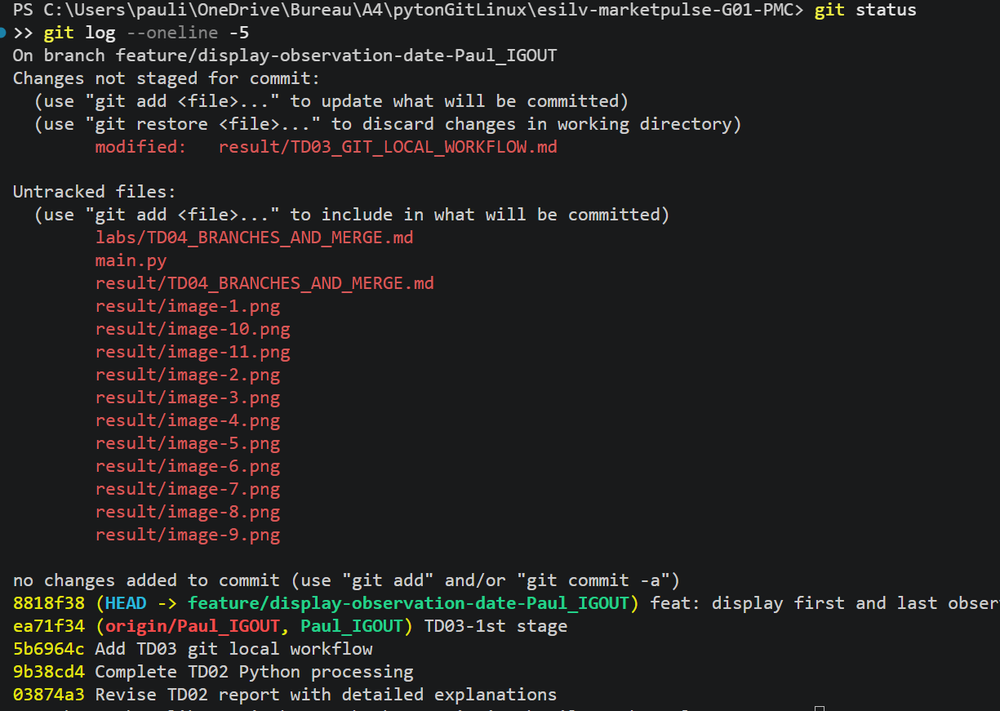

# TD04 - Branches + Merge

## Duration

```text
1 hour 30 minutes
```

## Business requirement

```text
"Features should no longer be developed directly on main."
```

## Context

TD03 introduced local Git history.

TD04 adds feature isolation.

The new question is:

> How can we develop a change without modifying the current main line until the change is ready?

Git branches provide that isolation.

The CORE workflow is:

```text
main
  |
  +--> feature branch
          |
          v
        change
          |
          v
        commit
          |
          v
        compare
          |
          v
        merge
          |
          v
         main
```

Pull Requests are not introduced yet.

They arrive in TD05.

## Learning objectives

At the end of TD04, you should be able to:

- explain why branches isolate feature work;
- identify the current branch;
- create a feature branch;
- switch between branches;
- make a meaningful commit on the feature branch;
- compare the branch with `main`;
- merge the completed branch into `main`;
- inspect the resulting Git graph;
- recognize what a merge conflict means;
- explain why direct feature work on `main` stops after this TD.

## CORE definition of done

TD04 is complete when each student can confirm:

```text
[ ] I started from a clean main branch
[ ] I created one feature branch
[ ] I implemented one small MarketPulse feature
[ ] I committed the feature on the branch
[ ] I compared the feature branch with main
[ ] I merged the feature into local main
[ ] I inspected the Git graph
[ ] I understand what a merge conflict means
[ ] MarketPulse still runs after the merge
[ ] Checkpoint A evidence is ready or can be captured
```

Executing a manufactured conflict is not required for CORE completion.

## Prerequisites

Before starting:

```text
[ ] TD01 completed
[ ] TD02 completed
[ ] TD03 completed
[ ] git status understood
[ ] git diff understood
[ ] git add understood
[ ] git commit understood
[ ] git log understood
[ ] python src/main.py works
```

Verify:

```bash
git status
git log --oneline -5
python src/main.py
```


Start from a clean working tree.

If unfinished work remains, resolve it with the instructor before creating the feature branch.

## Rule from TD04 onward

Feature work should no longer be developed directly on `main`.

The normal local pattern becomes:

```text
main
  |
  v
feature branch
  |
  v
change
  |
  v
commit
  |
  v
merge
```

TD05 will extend this pattern with GitHub collaboration.

## Session plan

The CORE is designed for approximately 80 minutes.

The final 10 minutes are reserved for Checkpoint A capture, questions or optional conflict practice.

| Time | Activity |
|---|---|
| 00-10 min | Branch mental model |
| 10-20 min | Create and inspect feature branch |
| 20-42 min | Implement small MarketPulse feature |
| 42-55 min | Commit and compare branches |
| 55-68 min | Merge into main and inspect graph |
| 68-75 min | Conflict concept and instructor demo |
| 75-80 min | CORE validation |
| 80-90 min | Checkpoint A capture / buffer / optional practice |

# CORE

# Part 1 - Understand branch isolation

A feature branch allows work to move independently from `main`.

Simplified model:

```text
main
  |
  o---o
      |
      +--> feature/display-observation-dates
                    |
                    o
```

Before the merge:

```text
main
!=
feature branch
```

After successful integration:

```text
feature result
+
main
=
updated main
```

# Part 2 - Inspect the current branch

Run:

```bash
git branch
git status
```

The current branch is marked with:


Before continuing, verify that you are on:

```text
main
```


and that the working tree is clean.

# Part 3 - Create a feature branch

Use the small MarketPulse feature:

```text
Display the first and last observation dates
for instrument and benchmark.
```

This builds directly on the TD02 data helpers.

Create:

```bash
git switch -c feature/display-observation-dates
```

Verify:

```bash
git branch
```

Expected shape:

```text
* feature/display-observation-dates
  main
```

Branch names should describe the work.

Good examples:

```text
feature/display-observation-dates
feature/yahoo-provider
fix/invalid-ticker
docs/update-readme
```

Avoid person-based or vague names such as:

```text
student1
mybranch
test
final
```

# Part 4 - Implement the small feature

Open:

```text
src/main.py
```

Create or reuse:

```python
def get_first_date(prices):
    return prices[0]["date"]


def get_last_date(prices):
    return prices[-1]["date"]
```

Integrate the dates into the existing reusable market summary.

Target idea:

```text
Instrument
AAPL - Apple Inc.
Observations : 21
First date   : 2026-09-01
Last date    : 2026-09-30
First close  : 250.00 USD
Last close   : 266.20 USD
```

Do not calculate returns yet.

Run:

```bash
python src/main.py
```

Verify that both instrument and benchmark display dates.

# Part 5 - Inspect and commit the branch change

Inspect:

```bash
git status
git diff
```

Stage the intended file:

```bash
git add src/main.py
```

Inspect what will be committed:

```bash
git diff --staged
```

Commit:

```bash
git commit -m "feat: display first and last observation dates"
```

Verify:

```bash
git status
git log --oneline -5
```

The feature commit belongs to the feature branch.

It is not yet integrated into `main`.

# Part 6 - Compare feature branch and main

Inspect the graph:

```bash
git log --oneline --graph --decorate --all
```

Identify:

```text
main
feature/display-observation-dates
```

Compare the branch with `main`:

```bash
git diff main..feature/display-observation-dates
```

Be able to answer:

1. Which change exists on the feature branch?
2. Why is that change not yet part of `main`?
3. What would happen if the branch were abandoned before merge?

ANSWERS :
1. The feature branch has the commit 8818f38, which adds the first and last observation dates to the market summary in src/main.py.
2. Because it was not merged yet: the base branch only contains the commits before it.
3. The commit would stay isolated on the branch, and the base branch would not change.
# Part 7 - Merge the feature into main

Switch back:

```bash
git switch main
```

Verify:

```bash
git branch
```

Merge:

```bash
git merge feature/display-observation-dates
```

Then inspect:

```bash
git log --oneline --graph --decorate --all
```

ANSWER:PS C:\Users\pauli\OneDrive\Bureau\A4\pytonGitLinux\esilv-marketpulse-G01-PMC> git log --oneline --graph --decorate --all
* 8818f38 (HEAD -> feature/display-observation-date-Paul_IGOUT) feat: display first and last observation dates
* ea71f34 (origin/Paul_IGOUT, Paul_IGOUT) TD03-1st stage
* 5b6964c Add TD03 git local workflow
* 9b38cd4 Complete TD02 Python processing
* 03874a3 Revise TD02 report with detailed explanations
* 1529420 Improve filter_prices and display_market_summary functions
* a4fdd57 Revise instrument and benchmark details in documentation
* 3e545cf Create TD02_Paul_IGOUT.md with project details
* 750f914 Add image to TDO1_Paul_IGOUT.md
* b5a8e9f Update TDO1_Paul_IGOUT.md with new content
* 15bfb0f Update TDO1_Paul_IGOUT.md
:...skipping...
* 8818f38 (HEAD -> feature/display-observation-date-Paul_IGOUT) feat: display first and last observation dates
* ea71f34 (origin/Paul_IGOUT, Paul_IGOUT) TD03-1st stage
* 5b6964c Add TD03 git local workflow
* 9b38cd4 Complete TD02 Python processing
* 03874a3 Revise TD02 report with detailed explanations
* 1529420 Improve filter_prices and display_market_summary functions
* a4fdd57 Revise instrument and benchmark details in documentation
* 3e545cf Create TD02_Paul_IGOUT.md with project details
* 750f914 Add image to TDO1_Paul_IGOUT.md
* b5a8e9f Update TDO1_Paul_IGOUT.md with new content
* 15bfb0f Update TDO1_Paul_IGOUT.md
* 538e885 Delete result/TD2_Paul_IGOUT
* 1029d47 Create TD2_Paul_IGOUT
* b744214 Revise TDO1_Paul_IGOUT.md for data updates
* 604d892 Revise TDO1_Paul_IGOUT.md with new sections
* 68123f5 Create TDO1_Paul_IGOUT.md for project documentation
* 2301cfb Ajout du dossier result
* 5207db8 first td session
* ba5c9f4 Update Readme
* 9fd6c8a Update Readme
* bfb94a6 init projecttemplate
~
~
~
~
~
~
~
~
~
~
~
~
~
~
~
~
~
~
(END)
* 8818f38 (HEAD -> feature/display-observation-date-Paul_IGOUT) feat: display first and last observation dates
* ea71f34 (origin/Paul_IGOUT, Paul_IGOUT) TD03-1st stage
* 5b6964c Add TD03 git local workflow
* 9b38cd4 Complete TD02 Python processing
* 03874a3 Revise TD02 report with detailed explanations
* 1529420 Improve filter_prices and display_market_summary functions
* a4fdd57 Revise instrument and benchmark details in documentation
* 3e545cf Create TD02_Paul_IGOUT.md with project details
* 750f914 Add image to TDO1_Paul_IGOUT.md
* b5a8e9f Update TDO1_Paul_IGOUT.md with new content
* 15bfb0f Update TDO1_Paul_IGOUT.md
* 538e885 Delete result/TD2_Paul_IGOUT
* 1029d47 Create TD2_Paul_IGOUT
* b744214 Revise TDO1_Paul_IGOUT.md for data updates
* 604d892 Revise TDO1_Paul_IGOUT.md with new sections
* 68123f5 Create TDO1_Paul_IGOUT.md for project documentation
* 2301cfb Ajout du dossier result
* 5207db8 first td session
* ba5c9f4 Update Readme
* 9fd6c8a Update Readme
* bfb94a6 init projecttemplate
~
~
~
~
~
~
~
~
~
~
~
~
~
~
~
~
~
~
(END)
* 8818f38 (HEAD -> feature/display-observation-date-Paul_IGOUT) feat: display first and last observation dates
* ea71f34 (origin/Paul_IGOUT, Paul_IGOUT) TD03-1st stage
* 5b6964c Add TD03 git local workflow
* 9b38cd4 Complete TD02 Python processing
* 03874a3 Revise TD02 report with detailed explanations
* 1529420 Improve filter_prices and display_market_summary functions
* a4fdd57 Revise instrument and benchmark details in documentation
* 3e545cf Create TD02_Paul_IGOUT.md with project details
* 750f914 Add image to TDO1_Paul_IGOUT.md
* b5a8e9f Update TDO1_Paul_IGOUT.md with new content
* 15bfb0f Update TDO1_Paul_IGOUT.md
:
* 8818f38 (HEAD -> feature/display-observation-date-Paul_IGOUT) feat: display first and last observation dates
* ea71f34 (origin/Paul_IGOUT, Paul_IGOUT) TD03-1st stage
* 5b6964c Add TD03 git local workflow
* 9b38cd4 Complete TD02 Python processing
* 03874a3 Revise TD02 report with detailed explanations
* 1529420 Improve filter_prices and display_market_summary functions
* a4fdd57 Revise instrument and benchmark details in documentation
* 3e545cf Create TD02_Paul_IGOUT.md with project details
* 750f914 Add image to TDO1_Paul_IGOUT.md
* b5a8e9f Update TDO1_Paul_IGOUT.md with new content
* 15bfb0f Update TDO1_Paul_IGOUT.md
:
* 8818f38 (HEAD -> feature/display-observation-date-Paul_IGOUT) feat: display first and last observation dates
* ea71f34 (origin/Paul_IGOUT, Paul_IGOUT) TD03-1st stage
* 5b6964c Add TD03 git local workflow
* 9b38cd4 Complete TD02 Python processing
* 03874a3 Revise TD02 report with detailed explanations
* 1529420 Improve filter_prices and display_market_summary functions
* a4fdd57 Revise instrument and benchmark details in documentation
* 3e545cf Create TD02_Paul_IGOUT.md with project details
* 750f914 Add image to TDO1_Paul_IGOUT.md
* b5a8e9f Update TDO1_Paul_IGOUT.md with new content
* 15bfb0f Update TDO1_Paul_IGOUT.md
* 538e885 Delete result/TD2_Paul_IGOUT
* 1029d47 Create TD2_Paul_IGOUT
* b744214 Revise TDO1_Paul_IGOUT.md for data updates
* 604d892 Revise TDO1_Paul_IGOUT.md with new sections
* 68123f5 Create TDO1_Paul_IGOUT.md for project documentation
* 2301cfb Ajout du dossier result
* 5207db8 first td session
* ba5c9f4 Update Readme
* 9fd6c8a Update Readme
* bfb94a6 init projecttemplate

Run MarketPulse:

```bash
python src/main.py
```

Be able to explain:

1. Is the feature now visible from `main`?
2. Is the feature commit still visible?
3. Did Git perform a fast-forward or create a merge commit?
4. What does the graph show?

ANSWERS:
1. Yes, after the merge the dates are displayed when running the project from the base branch.
2. Yes, the commit 8818f38 "feat: display first and last observation dates" is still visible in the history.
3. Git performed a fast-forward: no merge commit was created.
4. The graph is linear: 8818f38 sits on top of ea71f34 (TD03-1st stage), and HEAD points to it.

A fast-forward merge is valid.

Do not force a merge commit only to make the history look more complex.

# Part 8 - Capture Checkpoint A branch evidence, then clean the branch

Before deleting the merged feature branch, capture the branch-and-merge state required by:

```text
03_branch_merge.png
```

Run:

```bash
git branch
git branch --merged
git log --oneline --graph --decorate --all
```

A fast-forward merge is valid.

The graph may remain linear. In that case, the evidence should still show that:

```text
main contains the feature commit
+
feature/display-observation-dates is listed as merged
```

Do not force a merge commit only to create a more complex graph.

After the evidence is captured and the instructor confirms the merge:

```bash
git branch -d feature/display-observation-dates
```

Then:

```bash
git branch
git log --oneline --graph --decorate --all
```

The important history remains even after the local branch name is removed.

Do not use force deletion in the CORE.

# Part 9 - Understand merge conflicts

A merge conflict occurs when Git cannot automatically decide how to combine competing changes.

Conceptually:

```text
main changes one area
        +
feature changes the same area
        |
        v
Git cannot choose safely
        |
        v
human decision required
```

A conflict is not a Git failure.

It means integration requires interpretation.

Typical conflict markers may look like:

```text
<<<<<<< HEAD
content from current branch
=======
content from other branch
>>>>>>> feature/example
```

The resolution principle is:

```text
inspect
  |
  v
understand both versions
  |
  v
choose final content
  |
  v
remove markers
  |
  v
git add
  |
  v
complete merge
```

## Instructor demo

The instructor may demonstrate one controlled conflict using a harmless text file.

Students should focus on understanding:

- why the conflict occurred;
- what `git status` reports;
- what the markers mean;
- why a human must choose the final content.

Executing the complete manufactured conflict is OPTIONAL.

# Part 10 - CORE validation

Run:

```bash
git status
git log --oneline --graph --decorate --all
python src/main.py
```
PS C:\Users\pauli\OneDrive\Bureau\A4\pytonGitLinux\esilv-marketpulse-G01-PMC> git status
>> git log --oneline --graph --decorate --all
>> python src/main.py
On branch Paul_IGOUT
Your branch is ahead of 'origin/Paul_IGOUT' by 1 commit.
  (use "git push" to publish your local commits)

Changes not staged for commit:
  (use "git add <file>..." to update what will be committed)
  (use "git restore <file>..." to discard changes in working directory)
        modified:   result/TD03_GIT_LOCAL_WORKFLOW.md

Untracked files:
  (use "git add <file>..." to include in what will be committed)
        labs/TD04_BRANCHES_AND_MERGE.md
        main.py
        result/TD04_BRANCHES_AND_MERGE.md
        result/image-1.png
        result/image-10.png
        result/image-11.png
        result/image-12.png
        result/image-13.png
        result/image-14.png
        result/image-15.png
        result/image-16.png
        result/image-17.png
        result/image-2.png
        result/image-3.png
        result/image-4.png
        result/image-5.png
        result/image-6.png
        result/image-7.png
        result/image-8.png
        result/image-9.png

no changes added to commit (use "git add" and/or "git commit -a")
* 8818f38 (HEAD -> Paul_IGOUT) feat: display first and last observation dates
* ea71f34 (origin/Paul_IGOUT) TD03-1st stage
* 5b6964c Add TD03 git local workflow
* 9b38cd4 Complete TD02 Python processing
* 03874a3 Revise TD02 report with detailed explanations
* 1529420 Improve filter_prices and display_market_summary functions
* a4fdd57 Revise instrument and benchmark details in documentation
* 3e545cf Create TD02_Paul_IGOUT.md with project details
* 750f914 Add image to TDO1_Paul_IGOUT.md
* b5a8e9f Update TDO1_Paul_IGOUT.md with new content
* 15bfb0f Update TDO1_Paul_IGOUT.md
:
You should be able to explain:

```text
main
feature branch
branch creation
branch switch
branch commit
branch comparison
merge
fast-forward
merge conflict
```
ANSWERS:
main: the main line of the project, which should stay stable.
feature branch: a separate line of work to develop a change in isolation.
branch creation: git switch -c <'name'> creates a new branch and switches to it.
branch switch: git switch <'name'> moves to another branch.
branch commit: a commit made on the feature branch, not yet in main.
branch comparison: git diff main..<'branch'> shows what exists only on the branch.
merge: git merge <'branch'> integrates the branch's commits into the current branch.
fast-forward: a merge where the branch pointer just moves forward, with no merge commit.
merge conflict: when both branches changed the same lines, so Git cannot choose and a human must decide.

If the feature is integrated and the concepts are understood, TD04 CORE is complete.

# Part 11 - Checkpoint A

Checkpoint A is performed after TD04 and closes Checkpoint Phase A.

The canonical evidence contract is:

```text
docs/04_CHECKPOINTS_AND_EVIDENCE.md
```

For convenience, the required files are:

```text
README.md
01_terminal_python.png
02_git_status_log.png
03_branch_merge.png
```

Store them under:

```text
evidence/checkpoint-a/<github-username>/
```

Do not rename the files.

## Capture checklist

Before leaving TD04, verify:

```text
[ ] MarketPulse runs
[ ] git status is understandable
[ ] git log shows my work
[ ] 03_branch_merge.png was captured before the merged feature branch was deleted
[ ] branch and merge history are understandable, including a valid fast-forward if one occurred
[ ] evidence is attributable to my GitHub identity
[ ] no secret appears in a screenshot
```

Screenshots do not replace understanding.

For the official evidence rules, use `docs/04_CHECKPOINTS_AND_EVIDENCE.md`.

# OPTIONAL

Complete optional work only after the CORE definition of done and Checkpoint A preparation are under control.

## Optional 1 - Compare another branch

Create a harmless practice branch and use:

```bash
git diff main..<branch>
```

Explain what exists only on the branch.

## Optional 2 - Inspect graph decorations

Run:

```bash
git log --oneline --graph --decorate --all
```

Identify:

- current branch;
- `main`;
- recent commits.

## Optional 3 - File history

Run:

```bash
git log --oneline -- src/main.py
```

Then:

```bash
git show <commit-id> -- src/main.py
```

# ADVANCED

Complete advanced work only after TD04 CORE and Checkpoint A preparation are complete.

Advanced work is not required for Checkpoint A.

## ADV-GIT-01 - Conflict Resolution

Status:

```text
READY_TO_TEACH
```

Prerequisites:

```text
TD04 CORE complete
branch and merge understood
```

Estimated duration:

```text
30-45 minutes
```

Support:

[ADV-GIT-01 - Conflict Resolution](../advanced/ADV_GIT_01_CONFLICT_RESOLUTION.md)

The controlled conflict exercise previously listed under OPTIONAL now lives exclusively in this advanced support.

# TROUBLESHOOTING

## Cannot switch branches

Run:

```bash
git status
```

Uncommitted changes may prevent a safe switch.

Do not discard work blindly.

Ask the instructor if you are unsure.

## Merge says already up to date

Inspect:

```bash
git log --oneline --graph --decorate --all
```

You may already have merged the branch or created no new branch commit.

## Merge conflict appears unexpectedly

Run:

```bash
git status
```

Do not continue editing unrelated files.

Ask the instructor to help identify the competing changes before resolving them.

## Conflict markers remain

Search:

```bash
grep -R "<<<<<<<" .
```

Also inspect for:

```text
=======
>>>>>>>
```

Do not commit unresolved markers.

## MarketPulse fails after merge

Run:

```bash
python src/main.py
git status
git diff
```

Inspect the integrated code before creating more changes.

# Final readiness check

Each student should confirm:

```text
[ ] I can identify my current branch
[ ] I can create a feature branch
[ ] I can switch branches
[ ] I can commit on a feature branch
[ ] I can compare a feature branch with main
[ ] I can merge into main
[ ] I can inspect the Git graph
[ ] I understand fast-forward merge
[ ] I understand what causes a merge conflict
[ ] I understand that conflict execution was optional
[ ] MarketPulse still runs
[ ] Checkpoint A can be completed
```

# What comes next?

Checkpoint Phase A is now complete:

```text
Checkpoint Phase A - TD01-TD04
        |
        v
Checkpoint A
```

Pedagogical Wave 2 continues through TD06.

TD05 introduces remote collaboration:

```text
local feature branch
        |
        v
push
        |
        v
GitHub Pull Request
```

Before TD05 feature work begins, the team must establish one validated shared baseline.

Do not let several different local `main` histories become competing remote baselines.

The controlled handoff is:

```text
capture Checkpoint A
        |
        v
preserve each local TD04 history
        |
        v
select one validated team main
        |
        v
publish it to origin/main
        |
        v
all students align to origin/main
        |
        v
TD05 feature branches
```

The detailed procedure is at the start of TD05 and in `docs/03_GITHUB_TEAM_WORKFLOW.md`.

This synchronization is an operational handoff, not an advanced Git-history exercise.
